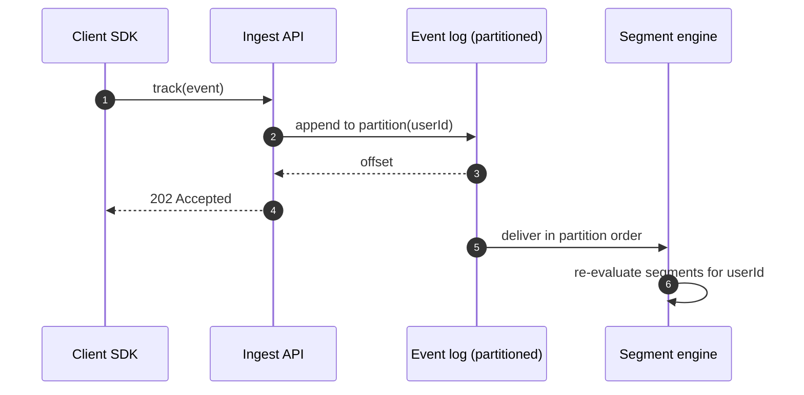

{/* Outline only. Replace each TODO with the real section. */}

## TODO: The problem

- What a customer data / segmentation engine does, in one paragraph.
- Why self-hosted matters to the people who'd run it.

## TODO: Why rebuild it

- What the existing approaches get wrong, without naming anyone.
- What "rebuild" means here: same job, new design.

## TODO: Why open source (Apache-2.0)

- Who it's for and how they'd adopt it.
- Why Apache-2.0 rather than another license.

## TODO: Why TypeScript

- Trade-offs, and where it will hurt.

## TODO: The shape of the system

- Event sourcing as the source of truth.
- Per-partition ordering.
- The segment engine.

Example diagram (replace it; it's here to confirm Mermaid renders at build time):



Example code block (replace it; it's here to confirm syntax highlighting):

```ts title="src/events/types.ts"
/** Placeholder: an ingested event, keyed so one user's events stay ordered. */
export interface SluiceEvent {
  id: string;
  userId: string;
  type: string;
  occurredAt: Date;
  properties: Record<string, unknown>;
}

export const partitionFor = (userId: string, partitions: number): number =>
  [...userId].reduce((h, c) => (h * 31 + c.charCodeAt(0)) >>> 0, 0) %
  partitions;
```

## TODO: How I'm building it (spec-first, AI-assisted)

- Specs and ADRs first, then code.
- What the AI does and what it doesn't.

## TODO: What's next in the series

- Planned posts and order.
